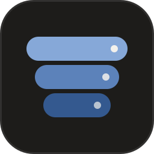
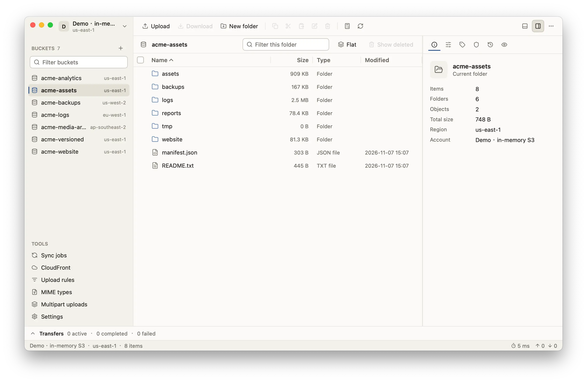

<p align="center">
  
</p>

<h1 align="center">Pail</h1>

<p align="center">
  A desktop client for Amazon S3, Cloudflare R2, MinIO and other S3-compatible storage.<br>
  Windows, macOS and Linux. Free and open source.
</p>

<p align="center">
  <a href="https://pail.download">Website</a> ·
  <a href="https://github.com/DejavuMoe/Pail/releases/latest">Download</a> ·
  <a href="https://pail.download/docs/">Documentation</a> ·
  <a href="README.zh-CN.md">简体中文</a>
</p>

<p align="center">
  <a href="https://awesomemygo.dev/apps/pail"></a>
</p>

<picture>
  <source media="(prefers-color-scheme: dark)" srcset="docs/images/main-dark-en.webp">
  
</picture>

## Features

- **Accounts.** Access keys, AWS profiles, the default credential chain, AssumeRole or anonymous access. A custom endpoint, region and path-style addressing for other services, with a connection test. A key that may not list buckets names them, each with the folder it may use. One proxy (HTTP, HTTPS or SOCKS5) for all accounts.
- **Browsing.** A sortable, multi-select object table that pages by itself, with breadcrumbs, filter, flat view and inspector. Preview text, images and hex. Copy keys, URIs and presigned URLs. Folder sizes on request.
- **Transfers.** Upload and download files, folders, versions and whole buckets, or drag files into the window. Separate queues with progress, speed, cancel and retry. Five policies for files that already exist. Large files go up in parts with checksums; downloads replace the target only after they are verified.
- **Object properties.** Headers, metadata, tags, ACL, storage class and server-side encryption (SSE-S3, SSE-KMS, SSE-C) for one object or a selection.
- **Versions.** List versions and delete markers, download or restore older versions, undelete keys, and permanently delete only the versions you select.
- **Buckets.** Create, empty, delete, and copy or move the contents. Edit 14 bucket settings as a form or JSON. List and abort incomplete multipart uploads. Give a bucket an alias.
- **Sync jobs.** Upload, download or mirror a folder. Compare by size and time, size, or checksum; exclude files by pattern; review the plan first.
- **Upload rules.** Match a bucket and key pattern to set headers, storage class and encryption, or to compress with GZIP, ZIP or AES-256 ZIP.
- **Links.** Presigned GET and PUT URLs with an expiry, for one version or many objects. An optional CDN domain per account. CloudFront invalidations for AWS accounts.
- **Interface.** Command palette (`Ctrl+K`, `⌘K` on macOS), keyboard shortcuts, English and Simplified Chinese, light and dark themes.

## Install

Download the archive for your system from the [latest release](https://github.com/DejavuMoe/Pail/releases/latest). The same files are mirrored at [pan.zsh.moe/Pail](https://pan.zsh.moe/Pail/).

- **Windows:** `Pail-v<version>-windows-amd64.zip` (x64) or `Pail-v<version>-windows-arm64.zip` (Arm)
- **macOS 11 or later:** `Pail-v<version>-darwin-arm64.zip` (Apple silicon) or `Pail-v<version>-darwin-amd64.zip` (Intel)
- **Linux:** `Pail-v<version>-linux-amd64.tar.gz` (x64) or `Pail-v<version>-linux-arm64.tar.gz` (Arm)

Each archive holds the desktop app and the `pail` command-line tool. macOS has `Pail.app`; Linux also has a `.desktop` entry and an icon. There are no 32-bit builds.

Executables are named with the version and platform. This document calls them `pail-desktop` and `pail`; rename the files or create aliases.

### Check the download

Compare the archive's SHA-256 hash with its line in `SHA256SUMS` from the same release:

```sh
sha256sum Pail-v0.5.3-linux-amd64.tar.gz           # Linux
shasum -a 256 Pail-v0.5.3-darwin-arm64.zip         # macOS
Get-FileHash Pail-v0.5.3-windows-amd64.zip         # Windows PowerShell
```

### First launch on macOS

The app is not signed or notarized, so macOS refuses to open a downloaded copy. Unzip the archive, move `Pail.app` to Applications, and clear the quarantine flag once:

```sh
xattr -dr com.apple.quarantine /Applications/Pail.app
```

### First launch on Windows

The executables are not signed. If SmartScreen says "Windows protected your PC", choose **More info**, then **Run anyway**.

## Quick start

1. Start `pail-desktop`. Open the account menu at the top of the sidebar and add an account. For a self-hosted or third-party service, enter:
   - the endpoint, such as `https://s3.example.com`, and the region, such as `us-east-1`;
   - the access key ID and secret access key;
   - **Path-style addressing**: on for MinIO and most self-hosted gateways, off for AWS;
   - optionally a **CDN URL**, such as `https://cdn.example.com`.

   Choose **Test connection**, then save. The secret key is stored in the system keychain.
2. Pick a bucket in the sidebar. Drag files into the window to upload them; select objects and choose **Download** to save them.

`pail-desktop` also accepts these flags:

| Flag | Effect |
| --- | --- |
| `--config-dir` | Use another configuration directory. |
| `--theme` | `system`, `light` or `dark`. |
| `--size` | Initial window size, such as `1280x800`. |
| `--tool` | Open a tool at start: `sync`, `cloudfront`, `rules`, `mime`, `multipart` or `settings`. |
| `--version` | Print the version and exit. |

## Command line

`pail` uses the accounts, saved sync jobs and settings of the desktop app. Add an account with `pail account add`, which asks for the secret access key without echo, or in the desktop app.

```sh
pail account add backup --endpoint https://s3.example.com --region us-east-1 --path-style --access-key-id AKIAEXAMPLE
pail accounts
pail ls s3://my-bucket/photos/ -r
pail cp ./dist s3://my-bucket/site/ -r --conflict newer
pail sync ./photos s3://my-bucket/photos/ --dry-run
pail presign s3://my-bucket/report.pdf --expires 1h
pail cat s3://my-bucket/notes.txt
```

Every command, its flags, JSON output and exit codes are in the [command-line reference](docs/cli.md).

## Data and privacy

- **Configuration** is the `Pail` folder in your user configuration directory (`%AppData%\Pail`, `~/Library/Application Support/Pail` or `~/.config/Pail`), or the directory you pass with `--config-dir`. It holds settings, accounts, sync jobs, upload rules and the names of stored secrets.
- **Secrets** (secret access keys, session tokens, proxy passwords) go to the system keychain under the name `Pail`. Without a keychain, use the encrypted vault in **Settings › Security**.
- **Logs** are off by default. When on, `logs/pail.log` leaves out URL query strings, Authorization headers, signatures and known secrets. Passwords typed by hand are recognised only by their label, so read a log before you share it.
- **Network:** Pail connects only to the endpoints of your accounts, through the proxy from **Settings › Network** or `HTTP_PROXY` and `HTTPS_PROXY`. It has no telemetry and does not check for updates.

## Tested platforms and services

- Desktop app: Windows, Linux and macOS (Apple silicon and Intel).
- Services: Amazon S3, Cloudflare R2, Wasabi, MinIO and VersityGW.
- AssumeRole credentials and CloudFront have not been tried on a real AWS account.

Known limitations are listed in the [changelog](CHANGELOG.md).

## Build from source

You need Go 1.27.3. No C compiler is required.

```sh
go build -o build/ ./cmd/pail-desktop ./cmd/pail
```

Tests, release packaging and the project layout are described in [CONTRIBUTING.md](CONTRIBUTING.md).

## License

Pail is released under the [MIT License](LICENSE). It bundles [Lucide](https://lucide.dev) icons (ISC License) and the Inter font (SIL Open Font License 1.1).

Amazon S3 is a trademark of Amazon.com, Inc. Pail is not affiliated with, endorsed by or sponsored by AWS.
