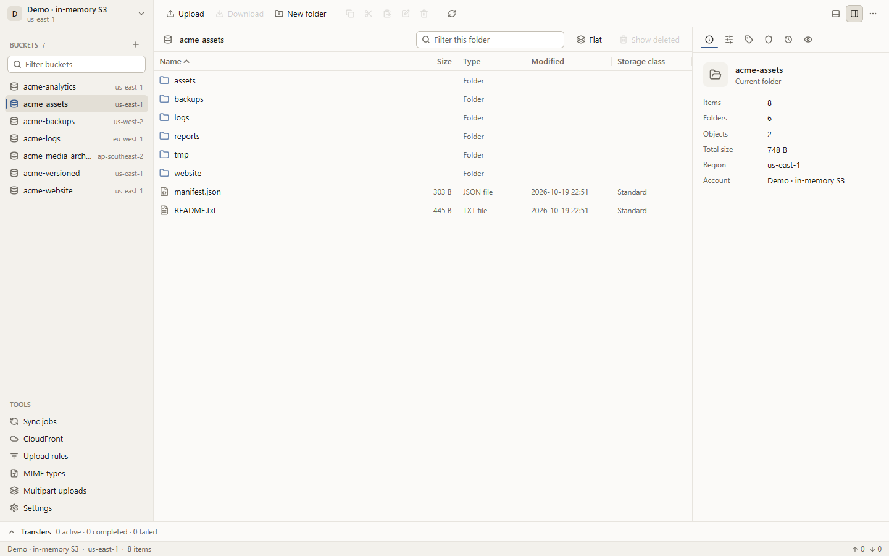
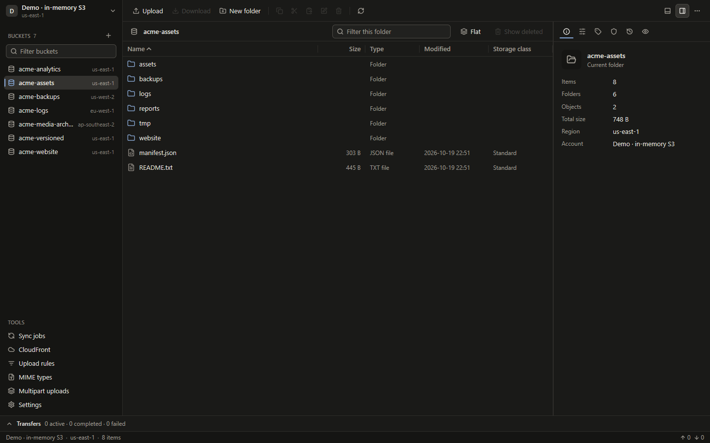

# Pail

[English](README.md) | 简体中文

Pail 是一款跨平台的桌面端 S3 兼容对象存储管理器，支持 Amazon S3、MinIO、Cloudflare R2、VersityGW、Wasabi 等兼容 S3 API 的服务。它使用 Go 和 [mygo](https://github.com/egoist/mygo) 界面库编写，可在 Windows、Linux 和 macOS 上运行，并附带命令行工具 `pail`。

Amazon S3 是 Amazon.com, Inc. 的商标。Pail 与 AWS 没有任何隶属、认可或赞助关系。




## 功能

**浏览**
- 账户数量不限，支持 AWS 与 S3 兼容服务（自定义端点、区域、路径样式、访问密钥、AWS profile、默认凭据链、匿名、AssumeRole），可测试连接。
- 存储桶列表、面包屑、可排序的多选对象表（自动分页）、搜索、平铺（不分层）视图、检查器面板。
- 预览 JSON、CSV、XML 等文本、图片和十六进制，大小有安全上限。
- 复制 key、URI、URL 和预签名 URL。

**传输**
- 上传和下载文件、文件夹、指定版本与整个存储桶，支持拖放。
- 上传、下载、其他三类独立队列，并发数可调，显示进度、速度，可取消和重试。
- 冲突策略：跳过、覆盖、重命名、较新则覆盖、大小不同则覆盖。
- 分片传输；按账户设置校验和模式（自动、仅在需要时、尽量发送）；仅创建（create-only）写入，不会覆盖并发写入的对象。
- 下载先写入临时文件，校验通过后才发布。

**对象属性**
- 编辑 headers、元数据、标签、ACL、存储类别和服务端加密（SSE-S3、SSE-KMS、SSE-C）；MIME 类型表。
- 编辑时保留所有未修改的属性，并在完成后复核结果。多选时会先确认范围。

**版本**
- 列出版本和删除标记，一次下载多个版本，恢复旧版本或已删除的 key，永久删除选中的版本。

**存储桶**
- 创建（区域、对象锁）、删除、清空，复制或移动整个存储桶的内容，对整个存储桶应用存储类别或加密。
- 14 项存储桶设置（版本控制、加密、策略、CORS、生命周期、日志、标签、静态网站、公共访问阻止、所有权、对象锁、请求者付费、传输加速、复制），可用表单或 JSON 编辑。服务不支持某项时显示"不支持"，而不是"未配置"。
- 未完成的分片上传：列出与中止。

**同步作业**
- 可保存的作业：上传、下载或镜像；按大小和时间、大小或校验和比较；排除规则；先预览。执行时只做预览过的动作，并逐项复核前提条件。本地删除进入系统回收站。

**上传规则与压缩**
- 按存储桶和 key 模式设置 headers、存储类别、加密和压缩：GZIP、ZIP 或 AES-256 ZIP，可调压缩级别。下载时可以解码压缩过的对象。

**CDN、预签名 URL 与 CloudFront**
- 每个账户可设置 CDN 域名（基础 URL 或含 `{bucket}`、`{key}` 的模板）：复制或打开对象的 CDN 链接，上传完成后也会提示。
- GET 或 PUT 的预签名 URL，可设置有效期、指定版本，一次处理多个对象。
- CloudFront（仅 AWS 账户）：列出 distribution、失效指定路径、失效整个存储桶对应的 distribution、查看失效记录。

**安全**
- 私有密钥和密码保存在系统钥匙串中，也可以选择加密保险库（Argon2id 派生密钥，XChaCha20-Poly1305 加密），绝不写入配置文件。
- 破坏性操作先显示范围，删除存储桶需要输入桶名。可选的诊断日志会脱敏。

**界面**
- 命令面板（`Ctrl+K`，macOS 为 `⌘K`）、右键菜单、键盘快捷键。
- 英文与简体中文，亮色与暗色主题，默认跟随系统。

## 安装

发布包由 `scripts/release.ps1` 生成在 `build/release/<version>/` 中，并附带 `SHA256SUMS` 文件。每个包内含桌面和 CLI 两个可执行文件、`LICENSE` 以及中英文 README。

| 系统 | 压缩包 |
| --- | --- |
| Windows | `Pail-v<version>-windows-amd64.zip`、`Pail-v<version>-windows-arm64.zip` |
| Linux | `Pail-v<version>-linux-amd64.tar.gz`、`Pail-v<version>-linux-arm64.tar.gz`（含 `pail.desktop` 和 `pail.png`） |
| macOS | `Pail-v<version>-darwin-amd64.zip`、`Pail-v<version>-darwin-arm64.zip`（内含 `Pail.app`） |

从 [Pail v0.1.0](https://github.com/DejavuMoe/Pail/releases/tag/v0.1.0) 下载，并用同一 Release 的 `SHA256SUMS` 校验压缩包。可执行文件名包含版本与目标平台，例如 `pail-desktop-v0.1.0-windows-amd64.exe` 和 `pail-v0.1.0-windows-amd64.exe`。macOS 保留 `Pail.app`，内部程序名同样包含版本。下文使用安装后的短名称 `pail-desktop` 和 `pail`；安装时可重命名或创建别名。Linux 的 `.desktop` 文件要求带版本的桌面程序位于 `PATH` 中。不提供 32 位桌面包。

可执行文件没有开发者代码签名，macOS 应用也没有公证，可能被 Gatekeeper 阻止。CI 要求原生自动化测试和版本冒烟通过，但这不等于 macOS 或 ARM64 的人工 GUI 验收。

## 快速开始

1. 启动 `pail-desktop`，在侧栏打开账户切换器并添加账户。以自建或第三方服务为例：
   - 端点 `https://s3.example.com`，区域 `us-east-1`，填入访问密钥 ID 和私有密钥；
   - 打开**路径样式**（MinIO 和大多数自建网关需要开启，AWS 保持关闭）；
   - 可选：设置 **CDN URL**，例如 `https://cdn.example.com`。

   点击"测试连接"，然后保存。私有密钥会存入系统钥匙串。
2. 在侧栏选择存储桶并浏览。把文件拖进窗口即可上传；选中对象后点击下载。
3. 没有凭据时可以先体验：运行 `pail-desktop --demo`，它连接的是进程内的内存 S3 服务，数据不会离开本机，也不会保存任何内容。

其他参数：`--config-dir DIR`、`--theme system|light|dark`、`--size WxH`、`--tool sync|cloudfront|rules|mime|multipart|settings`、`--version`。

## 命令行

`pail` 与桌面程序共用账户和同步作业：

```powershell
pail accounts
pail ls s3://my-bucket/photos/ -r
pail cp ./dist s3://my-bucket/site/ -r --conflict newer
pail sync ./photos s3://my-bucket/photos/ --mode new_changed --dry-run
pail presign s3://my-bucket/report.pdf --expires 1h
```

命令：`accounts`、`buckets`、`ls`、`cp`、`mv`、`rm`、`mb`、`rb`、`presign`、`url`、`versions`、`restore`、`sync`、`vault status`。JSON 输出、退出码和加密保险库的用法见 [docs/cli.zh-CN.md](docs/cli.zh-CN.md)。

## 从源码构建

`mise.toml` 锁定 Go 1.27.2、Node.js 24.19.0（仅 CI 脚本使用）与 PowerShell 7.6.7。先运行 `mise trust` 和 `mise install go node powershell`；未启用 shell 集成时，使用 `mise exec -- <命令>`。Go 依赖仍由 `go.mod` 和 `go.sum` 锁定。除 race 测试外不需要 cgo。

```powershell
go build ./cmd/pail-desktop ./cmd/pail
./scripts/release.ps1 -Version 0.1.0   # PowerShell 7.3+，交叉编译所有目标
go run ./tools/genicons                # 由 assets/brand/pail-icon.svg 重新生成图标
```

`scripts/release.ps1` 需要 `assets/brand/generated` 中已生成的图标。任何目标构建失败都会让脚本失败。发布前运行 `go run ./tools/verify-release -dir build/release/0.1.0 -version 0.1.0`，检查六个压缩包、校验和、二进制目标平台与执行权限。

## 测试

```powershell
go vet ./...
go test ./...
```

这些测试使用内存 S3 服务（`internal/s3test`）和 `httptest`，覆盖协议行为，但不涉及真实的服务商。

在 Docker 中对真实的 MinIO 测试（通过 WSL）：

```powershell
./scripts/test-integration.ps1                      # 固定版本的 MinIO
./scripts/test-integration.ps1 -MinioImage latest   # 最新的上游版本，从源码构建
```

对你自己的任意 S3 兼容端点测试，凭据只通过 `PAIL_EXT_*` 环境变量传入（`PAIL_EXT_ENDPOINT`、`PAIL_EXT_ACCESS_KEY`、`PAIL_EXT_SECRET_KEY`，可选 `PAIL_EXT_BUCKET`、`PAIL_EXT_REGION`、`PAIL_EXT_PATH_STYLE`、`PAIL_EXT_CDN`）：

```powershell
./scripts/test-external.ps1
```

测试只写入唯一的 `pail-e2e/<run>/` 前缀，结束后清理；不创建或删除存储桶，也不修改存储桶设置。详情见 [integration/README.md](integration/README.md)（英文）。

## 数据与隐私

- **配置**：系统用户配置目录下的 `Pail` 文件夹（Windows 为 `%AppData%\Pail`，Linux 为 `~/.config/Pail`，macOS 为 `~/Library/Application Support/Pail`），或 `--config-dir` 指定的路径。里面有设置、账户文件、同步作业、上传规则和机密引用的名称。如果存在旧名称留下的 `openS3` 文件夹，会在首次启动时自动迁移一次。
- **机密**：私有访问密钥、会话令牌和被引用的密码保存在系统钥匙串（Windows 凭据管理器、macOS 钥匙串、Linux 的 Secret Service），服务名为 `Pail`；也可以选择加密保险库 `vault.json`（设置 > 安全，适合没有钥匙串的环境）。访问密钥 ID 不是机密，保存在账户文件中。
- **日志**：默认关闭。开启后，脱敏后的日志写入配置目录下的 `logs/pail.log`。URL 查询串、Authorization 头、签名和已知的机密值都会被移除；手动输入的密码只能按标签识别，分享日志前请先检查。
- **网络**：Pail 只访问你配置的账户所对应的端点，没有遥测，也不检查更新。

## 平台状态

人工桌面检查覆盖 Windows 和 Linux（WSLg）。[CI 工作流](https://github.com/DejavuMoe/Pail/actions/workflows/ci.yml) 要求 Windows、Linux、macOS 的 amd64 和 arm64 原生测试及程序版本冒烟通过；结果以发布提交对应的运行记录为准。macOS 与 ARM64 的人工 GUI 验收仍待完成。目前用过的真实服务端：MinIO（两个版本）和 Cloudflare 后面的自建 VersityGW。AWS 本身，包括 STS 和 CloudFront，尚未测试。各功能的验证结果见 [docs/status.md](docs/status.md)，与 CS Browser Pro 的对照见 [docs/feature-matrix.md](docs/feature-matrix.md)。

## 文档

[docs/cli.zh-CN.md](docs/cli.zh-CN.md) · [docs/architecture.md](docs/architecture.md) · [docs/app-api.md](docs/app-api.md) · [docs/design.md](docs/design.md) · [docs/status.md](docs/status.md) · [docs/ci.md](docs/ci.md) · [docs/site.md](docs/site.md) · [CHANGELOG.zh-CN.md](CHANGELOG.zh-CN.md)

## 许可证

Pail 以 [MIT 许可证](LICENSE)发布，© 2026 Dejavu Moe。随附的第三方资源：[Lucide](https://lucide.dev) 图标（ISC）和 Inter 字体（SIL Open Font License 1.1，见 `cmd/pail-desktop/fonts/OFL.txt`）。

作者 [Dejavu Moe](https://dejavu.moe) · https://github.com/DejavuMoe/Pail
